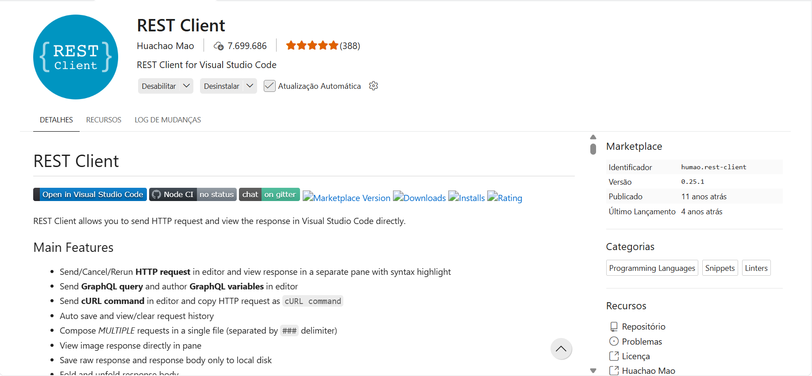

# 10-dwbe-node-express-phr

Link:

https://app.notion.com/p/Criando-uma-API-REST-61c44ced3625829e902501c1fd99e7c4

---

## Comandos Iniciais

```bash
sudo apt update
```

```bash
sudo apt install -y nodejs
```

```bash
node -v
```

```bash
npm install -g npm@11.19.0
```

```bash
npm -v
```
---

Criar o arquivo `.gitignore`:
 
```text
node_modules/
```

---

Iniciar o projeto:

```bash
npm init -y
```

No arquivo `package.json`, substituir ` "type": "commonjs"` por ` "type": "module"`:

Instalar o `Express`:

```bash
npm install express
```

```js
{
  "name": "10-dwbe-node-express-phr",
  "version": "1.0.0",
  "description": "Link:",
  "main": "index.js",
  "scripts": {
    "test": "echo \"Error: no test specified\" && exit 1"
  },
  "repository": {
    "type": "git",
    "url": "git+https://github.com/wdiasmaciel/10-dwbe-node-express-phr.git"
  },
  "keywords": [],
  "author": "",
  "license": "ISC",
  "type": "module",
  "bugs": {
    "url": "https://github.com/wdiasmaciel/10-dwbe-node-express-phr/issues"
  },
  "homepage": "https://github.com/wdiasmaciel/10-dwbe-node-express-phr#readme",
  "dependencies": {
    "express": "^5.3.0"
  }
}
```

---

## Servidor 01

Criar o arquivo:

```jsx
01-server.js
```

```js
import express from 'express';

const app = express();
app.use(express.json());

let usuarios = [
    { id:1, nome:"João" },
    { id:2, nome:"Maria" }
];

app.get("/", (req, res) => {
  res.json({
    mensagem: "API funcionando",
  });
});

app.get("/usuarios", (req, res) => {
  res.json(usuarios);
});

app.get("/usuarios/:id", (req, res) => {
  const id = parseInt(req.params.id);

  const usuario = usuarios.find((u) => u.id === id);

  if (!usuario) {
    return res.status(404).json({
      erro: "Usuário não encontrado",
    });
  }

  res.json(usuario);
});

app.post("/usuarios", (req, res) => {
  const novoUsuario = {
    id: usuarios.length + 1,
    nome: req.body.nome,
  };

  usuarios.push(novoUsuario);

  res.status(201).json(novoUsuario);
});

app.put("/usuarios/:id", (req, res) => {
  const id = parseInt(req.params.id);

  const usuario = usuarios.find((u) => u.id === id);

  if (!usuario) {
    return res.status(404).json({
      erro: "Usuário não encontrado",
    });
  }

  usuario.nome = req.body.nome;

  res.json(usuario);
});

app.delete("/usuarios/:id", (req, res) => {
  const id = parseInt(req.params.id);

  const index = usuarios.findIndex((u) => u.id === id);

  if (index === -1) {
    return res.status(404).json({
      erro: "Usuário não encontrado",
    });
  }

  usuarios.splice(index, 1);

  res.json({
    mensagem: "Usuário removido",
  });
});

app.listen(3000, () => {
  console.log("Servidor rodando na porta 3000");
});
```

Executar o servidor:

```bash
node 01-server.js
```

Abrir no navegador:

```text
http://localhost:3000
```

```text
{
  "mensagem": "API funcionando"
}
```

Abrir no navegador:

```text
http://localhost:3000/usuarios
```

```text
[
  {
    "id": 1,
    "nome": "João"
  },
  {
    "id": 2,
    "nome": "Maria"
  }
]
```

---

## Atualização Automática do Servidor

Atualização automática do servidor em caso de alteração do arquivo.

Atualizar o arquivo `package.json` adicionando a diretiva `dev1`:

```json
"scripts": {
    "test": "echo \"Error: no test specified\" && exit 1",
    "dev1" : "node --watch 01-server.js"
  }
```

```json
{
  "name": "10-dwbe-node-express-phr",
  "version": "1.0.0",
  "description": "Link:",
  "main": "index.js",
  "scripts": {
    "test": "echo \"Error: no test specified\" && exit 1",
    "dev1" : "node --watch 01-server.js"
  },
  "repository": {
    "type": "git",
    "url": "git+https://github.com/wdiasmaciel/10-dwbe-node-express-phr.git"
  },
  "keywords": [],
  "author": "",
  "license": "ISC",
  "type": "module",
  "bugs": {
    "url": "https://github.com/wdiasmaciel/10-dwbe-node-express-phr/issues"
  },
  "homepage": "https://github.com/wdiasmaciel/10-dwbe-node-express-phr#readme",
  "dependencies": {
    "express": "^5.3.0"
  }
}
```

Executar novamente o servidor digitando no terminal:

```bash
npm run dev1
```

## Teste

Instale a extensão `Rest Client` no `VS Code`:



Crie o arquivo `teste1.http`:

```js
@baseUrl = http://localhost:3000

### API funcionando
GET {{baseUrl}}/

### Listar todos os usuários
GET {{baseUrl}}/usuarios

### Buscar usuário existente
GET {{baseUrl}}/usuarios/1

### Buscar usuário inexistente
GET {{baseUrl}}/usuarios/999

### Criar usuário
POST {{baseUrl}}/usuarios
Content-Type: application/json

{
  "nome": "Ana"
}

### Atualizar usuário
PUT {{baseUrl}}/usuarios/1
Content-Type: application/json

{
  "nome": "João Silva"
}

### Remover usuário
DELETE {{baseUrl}}/usuarios/2
```

---

## Servidor 02

Criar a pasta `routes`.

Dento da pasta `routes`, criar o arquivo `usuarioRoutes.js`: 

```js
import express from 'express';

const router = express.Router();

let usuarios = [];

router.get('/', (req, res) => {
  res.json(usuarios);
});

router.get('/:id', (req, res) => {
  const id = parseInt(req.params.id);
  const usuario = usuarios.find((item) => item.id === id);

  if (!usuario) {
    return res.status(404).json({
      erro: 'Usuário não encontrado',
    });
  }

  res.json(usuario);
});

router.post('/', (req, res) => {
  const usuario = {
    id: usuarios.length + 1,
    nome: req.body.nome,
  };

  usuarios.push(usuario);
  res.status(201).json(usuario);
});

router.put('/:id', (req, res) => {
  const id = parseInt(req.params.id);
  const usuario = usuarios.find((item) => item.id === id);

  if (!usuario) {
    return res.status(404).json({
      erro: 'Usuário não encontrado',
    });
  }

  usuario.nome = req.body.nome;
  res.json(usuario);
});

router.delete('/:id', (req, res) => {
  const id = parseInt(req.params.id);
  const index = usuarios.findIndex((item) => item.id === id);

  if (index === -1) {
    return res.status(404).json({
      erro: 'Usuário não encontrado',
    });
  }

  usuarios.splice(index, 1);
  res.json({
    mensagem: 'Usuário removido',
  });
});

export default router;
```

Criar o arquivo:

```jsx
02-server.js
```

```js
import express from 'express';
import usuarioRoutes from "./routes/usuarioRoutes.js";

const app = express();

app.use(express.json());

app.use("/usuarios", usuarioRoutes);

app.listen(3001, () => {
  console.log("Servidor rodando");
});
```

Executar o servidor:

```bash
node 02-server.js
```

Abrir no navegador:

```text
http://localhost:3001
```

```text
http://localhost:3001/usuarios
```

## Teste

Crie o arquivo `teste2.http`:

```js
@baseUrl = http://localhost:3001

### Listar usuários
GET {{baseUrl}}/usuarios

### Criar usuário
POST {{baseUrl}}/usuarios
Content-Type: application/json

{
  "nome": "Ana"
}

### Buscar usuário existente
GET {{baseUrl}}/usuarios/1

### Buscar usuário inexistente
GET {{baseUrl}}/usuarios/999

### Atualizar usuário
PUT {{baseUrl}}/usuarios/1
Content-Type: application/json

{
  "nome": "Ana Silva"
}

### Remover usuário
DELETE {{baseUrl}}/usuarios/1
```

---

## Exercício

Usando Express, crie um servidor que aceite requisições para retornar em formato `JSON`:

1. Os nomes dos cursos de uma universidade.
2. Os nomes das disciplinas dos cursos.
3. Os nomes dos alunos matriculados em cada disciplina.

Teste a API criando um arquivo `.http` para a extensão `Rest Client`.